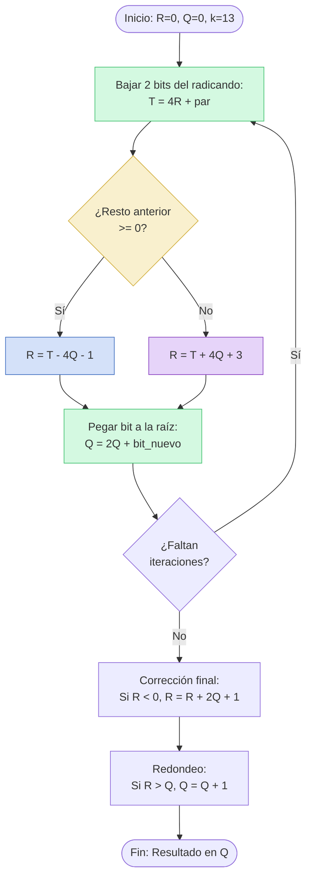

# Grupo 23 · SQRT

**Consigna:** Non restoring

## Integrantes
- De Los Santos, Dahiara Claribel (@dahizz)
- Kamchem, Melina (@melika2332)
- Wereszczuk, Danna Maira (@wereszczukdanna-cell)

## Archivos
- `alto_nivel/lab3a.cpp`: Programa en C++ con la demostración de conversión a formato Q, compatibilización de formatos (Q3.12 y Q7.8) y operaciones de suma, resta, producto y división.
- `asm/lab3a.asm`: Implementación en assembly LC-3 de las conversiones de formato y multiplicación en punto fijo, utilizando subrutinas de corrimiento (`SHL32`) y suma (`MULS`).
- `alto_nivel/sqrt_nr.cpp`: Análisis en C++ de la raíz cuadrada non-restoring, evaluación de formato, rango y precisión.
- `asm/sqrt_nr.asm`: Subrutina `SQRT_NR` en assembly LC-3 y programa de prueba.
- `bitacora_3a.md` y `bitacora_sqrt_nr.md`: Registros diarios de las sesiones de trabajo.

## Documentación Técnica (Lab 3b - SQRT Non-Restoring)
* **Algoritmo:** Raíz cuadrada "non-restoring" dígito a dígito (Li y Chu, 1996).
* **Integración y Compatibilidad:** Diseño encapsulado en "Caja Negra", 100% compatible con la interfaz del Grupo 27 (`main_menu_one_q7_8`). La subrutina recibe un único parámetro en `R0` y gestiona internamente sus iteraciones y estado, resguardando todos los registros del llamador.
* **Iteraciones (k):** 13 fijas inicializadas de forma interna. Es el máximo permitido para que el resto intermedio no desborde los registros de 16 bits con signo de la LC-3.
* **Formato Punto Fijo:**
  - **Entrada:** `Q7.8` (El radicando se carga en la mitad alta para ganar precisión sin usar más registros).
  - **Salida:** `Q6.9` (Calculado con la fórmula $f = n/2 + k - 8 = 9$ bits fraccionarios).
* **Rango de entrada aceptado:** `[0; 127.996]` (Si la entrada es negativa, la rutina devuelve `x8000` indicando error al sistema central).
* **Rango de salida:** `[0; 11.3145]`.
* **Precisión alcanzada:** Resolución (1 LSB) de `0.00195`, con un error máximo de `0.00098` (½ LSB) gracias al redondeo implementado en el último paso.

## Cómo probarlo
**Para Lab 3a:**
1. Cargar el archivo `asm/lab3a.asm` en el simulador de la LC-3 (LC3Tools o lc3web).
2. Poner un breakpoint en `ST R1, X_Q8` para verificar el corrimiento aritmético a la derecha.
3. Poner un breakpoint en `M_SIG` dentro de la subrutina `MULS` para observar cómo crece el producto parcial en los registros R1 y R2.
4. Ejecutar paso a paso y revisar los valores guardados en memoria (ej. `PROD_Q8` debe dar `xFC2C`).

**Para Lab 3b (SQRT Non-Restoring):**
1. Cargar el archivo `asm/sqrt_nr.asm` en el simulador.
2. Poner un breakpoint en la etiqueta `SQ_SIG` para observar el desarrollo vuelta por vuelta.
3. En cada parada, inspeccionar `R2` (resto) y `R3` (raíz parcial) para compararlos con la traza teórica.
4. Al finalizar la ejecución, verificar la memoria a partir de la etiqueta `SALIDAS` para ver las raíces calculadas en formato `Q6.9`.

## Diagrama de Flujo: Lazo Principal SQRT Non-Restoring

